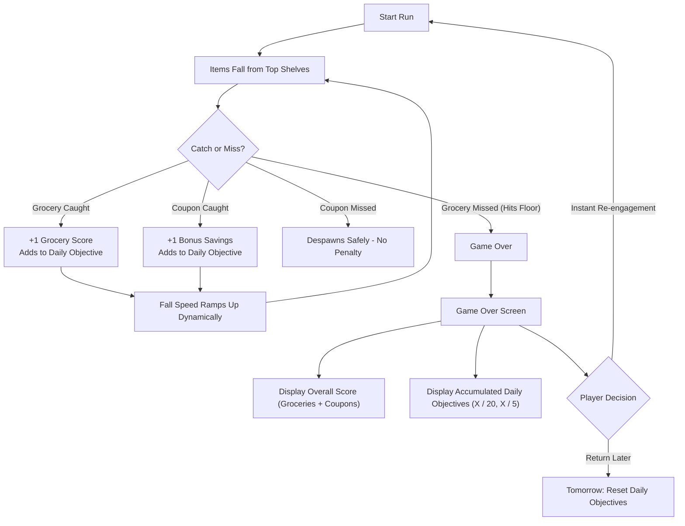

# 🛒 Cart Rush

> **A fast-paced 2D arcade physics catcher prototype built with Unity 6 (WebGL).**  

  

---

## 🎮 Playable Demo & Repository Links
* **🕹️ WebGL Playable Demo (One Click, Browser):** https://sriram-game-dev.itch.io/cart-rush
* **💻 GitHub Repository:** https://github.com/sriram-game-dev/Cart-Rush
* **📹 Gameplay Video Reference:** Included in project submissions (`Video_Project_2_(1).mp4`).

---

## 📌 Executive Pitch

- **What is it?** *Cart Rush* is a fast-paced 2D arcade physics game where players drag a supermarket shopping cart horizontally to catch falling groceries and bonus coupons while avoiding letting grocery items hit the floor.

- **Who is it for?** Casual and hyper-casual gamers looking for quick, engaging 60–90-second play sessions during breaks, commutes, or downtime, with gameplay designed for browser audiences.

- **Why play it?** Responsive drag controls, the tension of sudden-death grocery catching, risk-versus-reward coupon collection, and cumulative daily objectives create an easy-to-learn but challenging gameplay experience.

---

## 🔄 Core Gameplay Loop

  
  
<i>Live Gameplay: Catching bread and bonus coupons under dynamic gravity scaling.</i>

### 1. Risk vs. Reward Decision Making
* **Groceries (Apples, Bread, Milk):** Mandatory catches. Letting any grocery item touch the ground immediately triggers Game Over.
* **Coupons (Savings):** High-value bonus items that reward extra score and progress towards the secondary daily objective. Missing a coupon does *not* end the run, forcing split-second micro-decisions: *"Do I dive across the screen for the coupon or play safe to secure the falling grocery?"*

### 2. Dynamic Escalation
* As a run progresses, falling items dynamically accelerate using time-scaled gravity scaling ($0.3\times \rightarrow 2.5\times$ over 90 seconds), keeping runs short, tense, and exciting.

---

## 🎓 Onboarding & First-Time User Experience (FTUE)

  
  

<i>Left: "How to Play" rule overview. Right: 2-step interactive tutorial on first launch.</i>

1. **Rule Overview Dialog:** Displays clear, icon-driven rules before the first run (Click & drag to steer, catch groceries to score, collect coupons for bonus savings).
2. **Interactive 2-Step Hands-On:**
   * **Step 1:** *"Click the kart"* teaches the player direct interaction.
   * **Step 2:** *"Now, Drag left or right to collect the items"* validates movement before items start dropping.
3. **Smart Persistence:** Returning players skip the tutorial automatically and jump straight into gameplay.

---

## 📅 Day-1 (D1) Retention Hook & Metagame

  
  

<i>Left: Game Over screen showing Overall Score & live Daily Objective progress. Right: Cumulative progress carries across runs (e.g., 3/20 → 6/20).</i>

### The Built-in D1 Mechanism: Persistent Daily Objectives
1. **Cumulative Progress Across Sessions:**
   * **Objective 1:** Collect **20 Groceries** (`X / 20`)
   * **Objective 2:** Collect **5 Coupons** (`X / 5`)
2. **Failure-Friendly Design:** Even if a player fails a run in 10 seconds, every caught item counts towards their daily goals. This eliminates player frustration and encourages "just one more run."
3. **Midnight UTC Auto-Reset:** Progress persists locally across sessions throughout the calendar day using `DateTime.UtcNow` date-stamped `PlayerPrefs`. When the player returns tomorrow, fresh objectives generate automatically, providing a concrete reason to return daily.

### Long-Term Retention (Months)
The following features are planned to expand Cart Rush beyond its current prototype and encourage long-term player engagement.

- **New Locations & Aisle Theming:** Introduce unlockable supermarket aisles, including Produce, Bakery, Frozen Foods, and Delicatessen. Each location will feature unique grocery items, hazards, and gameplay mechanics.

- **Cart Collection & Customization:** Allow players to earn coupon currency and unlock cosmetic shopping carts, such as the Golden Trolley, Turbo Kart, and Wire Basket. Alternative checkout sound effects may also be introduced.

- **Card Passes & Special Upgrades:** Introduce Card Passes that provide access to special upgrades and optional ways to continue a run after failure.

- **Timed Challenges:** Add limited-time challenges that encourage players to improve their scores and replay the game.

- **Weekly Supermarket Sweep:** Explore asynchronous weekly tournaments with brackets of up to 50 players. Daily objective completion will award tickets for weekend high-score competitions.

- **Weekly Objective Streaks:** Introduce weekly goals and streak-based rewards to encourage consistent play.

- **Mobile Implementation :** Plan to expand Cart Rush to mobile devices in the future, with touchscreen drag controls and an interface optimized for smaller screens.

These features are part of the future development roadmap and are not available in the current prototype.

---

## 🕹️ Controls

| Control | Input Method | Platform |
| :--- | :--- | :--- |
| **Steer Cart** | Click/Touch & Drag anywhere horizontally | Desktop Mouse / Mobile Touchscreen |
| **Pause / Resume** | Click `⏸` icon in top-right | All Platforms |

---

## 💡 The 7 Design Pillars

### 1. The Pitch
* **Premise:** Supermarket checkout rush under physics chaos.
* **Target Audience:** Browser gamers seeking fast-acting reflex loops with zero learning curve.
* **Appeal:** Simple to understand in 3 seconds, challenging to master after 45 seconds, rewarding to complete daily.

### 2. Core Loop and First Session
* **First 60 Seconds:** Interactive 2-step tutorial introduces click-and-drag mechanics without walls of text. Players immediately catch their first groceries, experience the speed ramp, and discover coupons.
* **Why Return Tomorrow:** The Game Over screen clearly surfaces progress on the Daily Objective board. Seeing `14 / 20 groceries collected` drives the desire to complete today's quota; seeing tomorrow's reset countdown creates the Day-1 return impulse.

### 3. Progression and Metagame
**Day-1 Hook**
- **Daily Milestones:** Players complete cumulative grocery collection and coupon milestones to earn rewards.
- **Failure-Friendly Progression:** Daily progress is retained even if a player misses items or fails a run.
- **Daily Reset:** Daily objectives reset automatically based on the UTC calendar date.

**Long-Term Metagame**
- **New Locations:** Unlock new places to keep gameplay fresh.
- **Cart Collection:** Unlock better shopping carts as players progress.
- **Card Passes:** Use card passes to access special upgrades.
- **Timed Challenges:** Introduce time-limited challenges to encourage replayability.
- **Weekly Objective Streaks:** Reward consistent play through weekly goals and streaks.

### 4. Monetization Strategy

Cart Rush follows a player-friendly monetization approach that prioritizes optional rewards and purchases without forcing players to spend money.

- **Level Unlocks:** Spend earned in-game coins to unlock new levels or locations.
- **Cart Upgrades:** Collect coupons and convert them into coins to unlock better shopping carts.
- **Continue After Failure:** Resume a failed run by watching an optional rewarded advertisement or using a Card Pass.

The core gameplay remains accessible without requiring payment. Optional advertisements and in-game purchases provide additional progression opportunities while maintaining a fair experience for all players.

### 5. AI in Development & Game Design
* **How AI Was Used in Building:**
  * Served as an autonomous co-pilot for architectural refactoring, Unity 6 WebGL compatibility fixes (migrating to `rb.linearVelocity`), physics pooling synchronization (`Physics2D.SyncTransforms`), and robust state management.
* **AI in the Game Itself (Vision & Roadmap):**
  * *Current Build:* Deterministic, smooth dynamic difficulty adjustment (DDA) based on survival time and catch consistency.
  * *Future Integration:* A lightweight client-side heuristic model that measures player reaction latency and cart velocity to dynamically compose "flow-state" drop patterns, avoiding frustrating impossible splits while pushing players to their personal reflex limit.

### 6. Shipping & Analytics
**Initial Focus**
- **Input Feel and Responsiveness:** Prioritize smooth, responsive controls and minimize drag latency across touchscreen devices and mouse-based desktop browsers.
- **Fair Gameplay:** Ensure that player losses feel fair and are caused by gameplay decisions rather than unresponsive controls. Unfair input can negatively affect player retention.

**Soft Launch Key Performance Indicators (KPIs)**

| Metric | Target |
|---|---|
| Day-1 Retention (D1) | 35%–40% or higher |
| Day-7 Retention (D7) | 12%–15% or higher |
| Average Runs per Daily Active User (DAU) | 4.5 or more runs/day |
| Daily Objective Completion Rate | 60% or higher |

**Kill / Pivot Signals**
- **Low Day-1 Retention:** If D1 retention remains below 22% despite input improvements, reassess the core gameplay loop and early-game difficulty.
- **Post-Failure Drop-Off:** If players frequently leave immediately after their first death, consider replacing the sudden-death system with a **3-strikes or health-bar system** to make failure more forgiving.

These KPIs are initial targets for soft-launch testing, not measured results. Use playtest data to validate and refine them.

### 7. Reference Games & Deconstruction

- **Thomsons & Touch Java Game (Dad, Catch!):** Borrowed by its falling-and-catching gameplay mechanic to build the core gameplay of Cart Rush, creating a simple, engaging experience that encourages players to react quickly and keep playing.

- **Banana Kong:** Inspired the idea of rewarding continued effort across multiple runs through cumulative progress and objectives, encouraging players to return and improve their overall progress.

- **Hill Climb Racing:** Inspired the progression concept of unlocking upgrades and new levels, giving players long-term goals to work toward as they earn in-game rewards.

These games serve as design references for Cart Rush's core gameplay, replayability, and progression ideas.

---

## 🛠️ Technical Architecture & Key Scripts

The codebase follows a modular singleton manager architecture designed for high performance and zero garbage collection during WebGL execution:

* **[`GameManager.cs`](file:///d:/Experiment/unity/MY%20Projects/Cart%20Rush/Assets/Cart%20Rush/Scripts/Managers/GameManager.cs):**
  * Manages object pools for all falling items (`Object_1`, `Object_2`, `Object_3`, `Bonus`).
  * Enforces `Physics2D.SyncTransforms()` and explicit `rb.position` updates on reuse to eliminate teleportation collision glitches.
  * Controls dynamic difficulty escalation (`startGravityScale` $\rightarrow$ `maxGravityScale`).
* **[`PlayerController.cs`](file:///d:/Experiment/unity/MY%20Projects/Cart%20Rush/Assets/Cart%20Rush/Scripts/Gameplay/PlayerController.cs):**
  * Handles input agnostic movement (mouse drag anywhere on screen, touchscreen swipe, and keyboard `A`/`D`/Arrow keys).
  * Manages the first-time interactive tutorial state machine.
* **[`UIManager.cs`](file:///d:/Experiment/unity/MY%20Projects/Cart%20Rush/Assets/Cart%20Rush/Scripts/Managers/UIManager.cs):**
  * Orchestrates screen transitions: Opening Title $\rightarrow$ Tutorial $\rightarrow$ Gameplay HUD $\rightarrow$ Pause $\rightarrow$ Game Over.
  * Updates real-time in-game score cards and final Game Over statistics.
* **[`PlayerPrefsManager.cs`](file:///d:/Experiment/unity/MY%20Projects/Cart%20Rush/Assets/Cart%20Rush/Scripts/Managers/PlayerPrefsManager.cs):**
  * Persistent storage for login status and daily objective progress.
  * Performs UTC calendar date verification (`DateTime.UtcNow.ToString("yyyy-MM-dd")`) to automatically reset daily quotas at midnight.
* **[`Trigger_Groceries.cs`](file:///d:/Experiment/unity/MY%20Projects/Cart%20Rush/Assets/Cart%20Rush/Scripts/Triggers/Trigger_Groceries.cs) & [`Trigger_Bonus.cs`](file:///d:/Experiment/unity/MY%20Projects/Cart%20Rush/Assets/Cart%20Rush/Scripts/Triggers/Trigger_Bonus.cs):**
  * Fast 2D collision trigger handling with state-locking (`isHandled`) and height validation (`Y < -2.5f`) to prevent false triggers during object pooling.

---

## 🚀 How to Run & Build

### In Unity Editor
1. Open the project in **Unity 6 (6000.3.24f1)**.
2. In the Project window, navigate to `Assets/Cart Rush/Scenes/` and double-click `Cart_Rush_WebGL_0.0.0.unity`.
3. Press **Play (Ctrl + P)**.

### Exporting for WebGL (One-Click Playable Browser Link)
1. In Unity, go to **File $\rightarrow$ Build Profiles** (or **Build Settings**).
2. Switch target platform to **WebGL**.
3. Ensure `Assets/Cart Rush/Scenes/Cart_Rush_WebGL_0.0.0.unity` is listed in **Scenes In Build**.
4. Click **Build** and choose an output directory (e.g., `Build_WebGL/`).
5. **Publishing options:**
   * **itch.io (Recommended):** Compress the build folder contents (`index.html`, `Build/`, `TemplateData/`) into a `.zip` archive, upload to itch.io, and mark as **"This file will be played in the browser"**.
   * **GitHub Pages:** Commit the build folder to a `gh-pages` branch or configure GitHub Pages from `/docs`.
