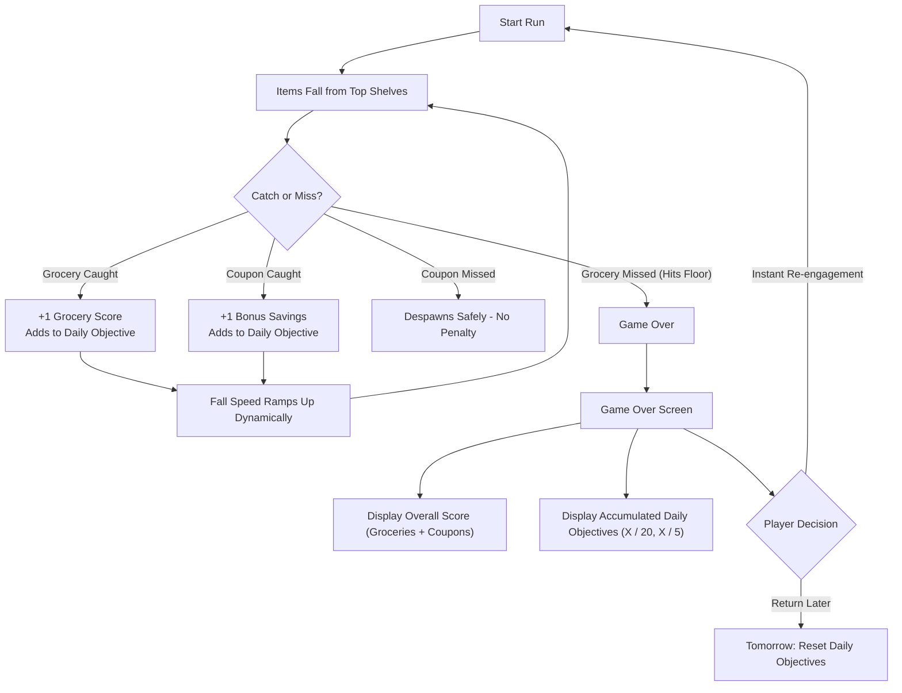

# 🛒 Cart Rush

> **A fast-paced 2D arcade physics catcher prototype built with Unity 6 (WebGL).**  

  

---

## 🎮 Playable Demo & Repository Links
* **🕹️ WebGL Playable Demo (One Click, Browser):** https://sriram-game-dev.itch.io/cart-rush
* **💻 GitHub Repository:** `[INSERT_YOUR_GITHUB_REPO_URL_HERE]`
* **📹 Gameplay Video Reference:** Included in project submissions (`Video_Project_2_(1).mp4`).

---

## 📌 Executive Pitch
* **What is it?** *Cart Rush* is an intuitive, fast-reflex 2D arcade physics game where players drag a supermarket shopping cart horizontally to catch falling groceries and bonus coupons while avoiding letting any grocery item touch the floor.
* **Who is it for?** Casual and hyper-casual mobile/browser gamers (ages 16–35) looking for quick, punchy 60-to-90-second play sessions during commutes, study breaks, or daily downtime.
* **Why play it?** The immediate 1:1 tactile drag responsiveness, high-stakes sudden-death catching tension, risk-vs-reward bonus coupons, and a clear daily objective progression loop.

---

## 🔄 Core Gameplay Loop

  
  
<i>Live Gameplay: Catching bread and bonus coupons under dynamic gravity scaling.</i>

### 1. Risk vs. Reward Decision Making
* **Groceries (Apples, Bread, Milk):** Mandatory catches. Letting any grocery item touch the ground immediately triggers Game Over.
* **Coupons (Savings):** High-value bonus items that reward extra score and progress towards the secondary daily objective. Missing a coupon does *not* end the run, forcing split-second micro-decisions: *"Do I dive across the screen for the coupon or play safe to secure the falling grocery?"*

### 2. Dynamic Escalation
* As a run progresses, falling items dynamically accelerate using time-scaled gravity scaling ($0.3\times \rightarrow 2.5\times$ over 90 seconds), keeping runs short, tense, and exciting.

---

## 🎓 Onboarding & First-Time User Experience (FTUE)

  
  

<i>Left: "How to Play" rule overview. Right: 2-step interactive tutorial on first launch.</i>

1. **Rule Overview Dialog:** Displays clear, icon-driven rules before the first run (Click & drag to steer, catch groceries to score, collect coupons for bonus savings).
2. **Interactive 2-Step Hands-On:**
   * **Step 1:** *"Click the kart"* teaches the player direct interaction.
   * **Step 2:** *"Now, Drag left or right to collect the items"* validates movement before items start dropping.
3. **Smart Persistence:** Returning players skip the tutorial automatically and jump straight into gameplay.

---

## 📅 Day-1 (D1) Retention Hook & Metagame

  
  

<i>Left: Game Over screen showing Overall Score & live Daily Objective progress. Right: Cumulative progress carries across runs (e.g., 3/20 → 6/20).</i>

### The Built-in D1 Mechanism: Persistent Daily Objectives
1. **Cumulative Progress Across Sessions:**
   * **Objective 1:** Collect **20 Groceries** (`X / 20`)
   * **Objective 2:** Collect **5 Coupons** (`X / 5`)
2. **Failure-Friendly Design:** Even if a player fails a run in 10 seconds, every caught item counts towards their daily goals. This eliminates player frustration and encourages "just one more run."
3. **Midnight UTC Auto-Reset:** Progress persists locally across sessions throughout the calendar day using `DateTime.UtcNow` date-stamped `PlayerPrefs`. When the player returns tomorrow, fresh objectives generate automatically, providing a concrete reason to return daily.

### Long-Term Retention (Months)
* **Aisle Theming:** Unlocking new supermarket aisles (Produce $\rightarrow$ Bakery $\rightarrow$ Frozen Foods $\rightarrow$ Delicatessen) with distinctive physics (e.g., fragile eggs with smaller hitboxes, bouncing frozen turkeys, slippery soap hazards).
* **Cosmetic Trolleys:** Earning coupon currency to unlock visual shopping carts (Golden Trolley, Turbo Kart, Wire Basket) and checkout sound effects.
* **Weekly Supermarket Sweep:** Asynchronous weekly brackets (50 players) where daily objective completion awards tickets into weekend high-score tournaments.

---

## 🕹️ Controls

| Control | Input Method | Platform |
| :--- | :--- | :--- |
| **Steer Cart** | Click/Touch & Drag anywhere horizontally | Desktop Mouse / Mobile Touchscreen |
| **Keyboard Left** | `A` or `Left Arrow` | WebGL / Desktop |
| **Keyboard Right** | `D` or `Right Arrow` | WebGL / Desktop |
| **Pause / Resume** | Click `⏸` icon in top-right | All Platforms |

---

## 💡 The 7 Design Pillars (Challenge Questionnaire)

### 1. The Pitch
* **Premise:** Supermarket checkout rush under physics chaos.
* **Target Audience:** Casual mobile and browser gamers seeking fast-acting reflex loops with zero learning curve.
* **Appeal:** Simple to understand in 3 seconds, challenging to master after 45 seconds, rewarding to complete daily.

### 2. Core Loop and First Session
* **First 60 Seconds:** Interactive 2-step tutorial introduces click-and-drag mechanics without walls of text. Players immediately catch their first groceries, experience the speed ramp, and discover coupons.
* **Why Return Tomorrow:** The Game Over screen clearly surfaces progress on the Daily Objective board. Seeing `14 / 20 groceries collected` drives the desire to complete today's quota; seeing tomorrow's reset countdown creates the Day-1 return impulse.

### 3. Progression and Metagame
* **Day-1 Hook:** Cumulative daily grocery and coupon milestones that do not punish failure and reset daily via local UTC date checks.
* **Long-Term Metagame:** Unlocking new aisles with unique hazards, seasonal Club Card battle passes, cosmetic cart customizations, and weekend tournament tiers.

### 4. Monetization Strategy
* **Non-Aggressive, Fair Monetization:**
  * **Optional Rewarded Video (Limit 1/run):** "Express Checkout" revive offering a single second chance per run without inflating leaderboard scores.
  * **Club Card Battle Pass:** Cosmetic-only tracks rewarding seasonal cart skins, grocery trails, and custom checkout chimes.
  * **No Energy Bars:** The core loop is never gated behind paywalls or cooldown timers; player engagement is respected.

### 5. AI in Development & Game Design
* **How AI Was Used in Building:**
  * Served as an autonomous co-pilot for architectural refactoring, Unity 6 WebGL compatibility fixes (migrating to `rb.linearVelocity`), physics pooling synchronization (`Physics2D.SyncTransforms`), and robust state management.
* **AI in the Game Itself (Vision & Roadmap):**
  * *Current Build:* Deterministic, smooth dynamic difficulty adjustment (DDA) based on survival time and catch consistency.
  * *Future Integration:* A lightweight client-side heuristic model that measures player reaction latency and cart velocity to dynamically compose "flow-state" drop patterns, avoiding frustrating impossible splits while pushing players to their personal reflex limit.

### 6. Shipping & Analytics
* **Initial Focus:** Input feel and drag latency across touchscreens and mouse viewports. If player loss feels unfair due to controls, retention collapses.
* **Soft Launch Key Performance Indicators (KPIs):**
  * **D1 Retention:** Benchmark target $\ge 35\% - 40\%$.
  * **D7 Retention:** Benchmark target $\ge 12\% - 15\%$.
  * **Average Runs / Daily Active User:** $\ge 4.5$ runs/day.
  * **Daily Objective Completion Rate:** $\ge 60\%$.
* **Kill / Pivot Signals:** If Day-1 retention falls below $22\%$ despite input tuning, or if session drop-off happens immediately after the first death, pivot the failure model from sudden-death to a 3-strikes / health-bar system.

### 7. Reference Games & Deconstruction
* **Fruit Ninja (Halfbrick):** Borrowed the sudden-death urgency of missed mandatory items; altered by replacing freeform screen slashing with positioning an umbrella/paddle catcher.
* **Alto's Adventure:** Borrowed the non-punitive, cumulative goal system that rewards aggregate effort across multiple runs.
* **Overcooked:** Borrowed the relatable, high-stress domestic theme of frantic food handling over abstract geometric shapes.

---

## 🛠️ Technical Architecture & Key Scripts

The codebase follows a modular singleton manager architecture designed for high performance and zero garbage collection during WebGL execution:

* **[`GameManager.cs`](file:///d:/Experiment/unity/MY%20Projects/Cart%20Rush/Assets/Cart%20Rush/Scripts/Managers/GameManager.cs):**
  * Manages object pools for all falling items (`Object_1`, `Object_2`, `Object_3`, `Bonus`).
  * Enforces `Physics2D.SyncTransforms()` and explicit `rb.position` updates on reuse to eliminate teleportation collision glitches.
  * Controls dynamic difficulty escalation (`startGravityScale` $\rightarrow$ `maxGravityScale`).
* **[`PlayerController.cs`](file:///d:/Experiment/unity/MY%20Projects/Cart%20Rush/Assets/Cart%20Rush/Scripts/Gameplay/PlayerController.cs):**
  * Handles input agnostic movement (mouse drag anywhere on screen, touchscreen swipe, and keyboard `A`/`D`/Arrow keys).
  * Manages the first-time interactive tutorial state machine.
* **[`UIManager.cs`](file:///d:/Experiment/unity/MY%20Projects/Cart%20Rush/Assets/Cart%20Rush/Scripts/Managers/UIManager.cs):**
  * Orchestrates screen transitions: Opening Title $\rightarrow$ Tutorial $\rightarrow$ Gameplay HUD $\rightarrow$ Pause $\rightarrow$ Game Over.
  * Updates real-time in-game score cards and final Game Over statistics.
* **[`PlayerPrefsManager.cs`](file:///d:/Experiment/unity/MY%20Projects/Cart%20Rush/Assets/Cart%20Rush/Scripts/Managers/PlayerPrefsManager.cs):**
  * Persistent storage for login status and daily objective progress.
  * Performs UTC calendar date verification (`DateTime.UtcNow.ToString("yyyy-MM-dd")`) to automatically reset daily quotas at midnight.
* **[`Trigger_Groceries.cs`](file:///d:/Experiment/unity/MY%20Projects/Cart%20Rush/Assets/Cart%20Rush/Scripts/Triggers/Trigger_Groceries.cs) & [`Trigger_Bonus.cs`](file:///d:/Experiment/unity/MY%20Projects/Cart%20Rush/Assets/Cart%20Rush/Scripts/Triggers/Trigger_Bonus.cs):**
  * Fast 2D collision trigger handling with state-locking (`isHandled`) and height validation (`Y < -2.5f`) to prevent false triggers during object pooling.

---

## 🚀 How to Run & Build

### In Unity Editor
1. Open the project in **Unity 6 (6000.3.24f1)**.
2. In the Project window, navigate to `Assets/Cart Rush/Scenes/` and double-click `Cart_Rush_WebGL_0.0.0.unity`.
3. Press **Play (Ctrl + P)**.

### Exporting for WebGL (One-Click Playable Browser Link)
1. In Unity, go to **File $\rightarrow$ Build Profiles** (or **Build Settings**).
2. Switch target platform to **WebGL**.
3. Ensure `Assets/Cart Rush/Scenes/Cart_Rush_WebGL_0.0.0.unity` is listed in **Scenes In Build**.
4. Click **Build** and choose an output directory (e.g., `Build_WebGL/`).
5. **Publishing options:**
   * **itch.io (Recommended):** Compress the build folder contents (`index.html`, `Build/`, `TemplateData/`) into a `.zip` archive, upload to itch.io, and mark as **"This file will be played in the browser"**.
   * **GitHub Pages:** Commit the build folder to a `gh-pages` branch or configure GitHub Pages from `/docs`.
